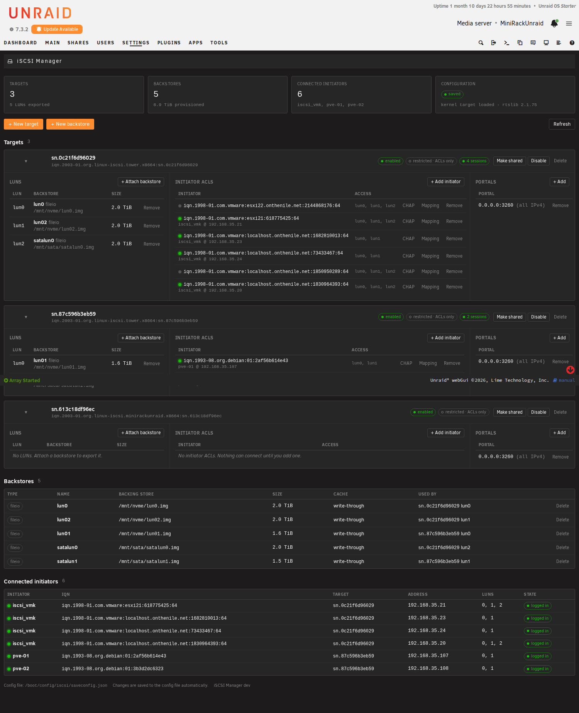

# iSCSI Manager for Unraid

A single-page iSCSI target manager for Unraid 6.12+ / 7.x, built as a
replacement front end for the [unraid.iSCSI](https://github.com/SimonFair/unraid.iSCSI)
plugin. Same kernel target (LIO), same `targetcli` runtime, same configuration
file, but one readable page instead of seven tabs of raw `targetcli ls` output.



## What it does

* **Targets** as cards: enabled/disabled, shared or restricted access mode,
  CHAP state, live session count, and inline tables for LUNs, initiator ACLs
  and portals with add/remove on each.
* **Initiator ACLs** with a live status dot, the initiator's alias and IP when
  it is logged in, per-ACL CHAP (plus mutual CHAP), and per-LUN read-only mapping.
* **Backstores**: image files (sparse fileio) or whole unassigned block devices.
  Devices that belong to the array, pools or the flash drive are never offered.
* **Connected initiators** table across all targets, refreshed every 10 s.
* **Auto-save**: every change is written to `/boot/config/iscsi/saveconfig.json`
  so it survives a reboot and an array stop/start.
* Follows the Unraid theme (white / black / azure / gray) via the webGui's own
  CSS variables.

## How it works

```
iSCSIManager.page           Unraid page shell (Settings > iSCSI Manager)
javascript/iscsi.js         renders everything from one JSON state document
include/api.php             POST-only JSON endpoint, CSRF-checked by Unraid
include/iscsi_ctl.py        all the real work, via rtslib_fb (targetcli's library)
event/disks_mounted         restores the saved config when the array starts
event/unmounting_disks      clears the live config so the array can stop
```

Reading state through rtslib takes ~0.15 s and gives structured data, so
there is no parsing of `targetcli` output anywhere. Mutations take a file lock,
apply the change through rtslib, save the config, and return the fresh state in
the same response.

## Installing

The plugin needs the targetcli runtime (Python 3.9 + targetcli-fb). The `.plg`
downloads SimonFair's runtime package and installs it only if `targetcli` is
not already on the system, so it coexists with the original plugin and shares
its configuration.

**From a release URL** (Plugins > Install Plugin):

```
https://raw.githubusercontent.com/<you>/unraid-iscsi/main/iscsi.manager.plg
```

Update `gitURL` in `iscsi.manager.plg` and host `packages/iscsi.manager-<ver>.txz`
at that location.

**Straight from this checkout** (no hosting needed):

```
./install-local.sh        # builds the package, copies it to the flash, runs `plugin install`
```

**Fast development loop** (not persistent across reboots):

```
./deploy-dev.sh           # rsync src/ into the live webGui; reload the page
```

Both scripts read the host from `UNRAID_HOST` (default `192.168.35.2`) and the
root credentials from `UNRAID_CREDS` (default `../unraid-cred`).

## Building

```
./build.sh [version]      # -> packages/iscsi.manager-<version>.txz and stamps the .plg
```

## Notes and limits

* One TPG per target (tpg1), which is what targetcli creates and what every
  initiator expects.
* CHAP is per initiator ACL. Target-wide CHAP for shared (demo) mode targets is
  not exposed yet.
* Removing the plugin keeps the runtime and the live targets; it never takes
  storage away from connected hosts.
* A `saveconfig.json` backup is left in `/etc/target/backup/` by rtslib on every save.
